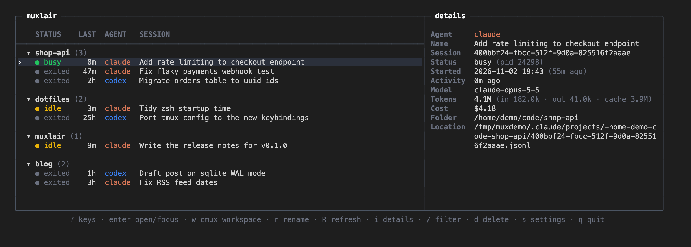

# muxlair

[](https://github.com/phr0nak/muxlair/actions/workflows/ci.yml)
[](LICENSE)
[](go.mod)
[](https://github.com/phr0nak/muxlair/tags)



A terminal dashboard for your local AI coding-agent sessions. `muxlair` lists your Claude Code and Codex sessions grouped by the folder they ran in. From there you can jump to a running session, reopen an old one, rename it or clean it up, using the keyboard or the mouse, inside [tmux](https://github.com/tmux/tmux) or [cmux](https://cmux.com).

### Why "muxlair"?

The name joins two words:

- **mux**, from *multiplexer*, as in `tmux`: many terminal sessions managed through one interface.
- **lair**, a hidden base or den: a dedicated place where your AI agents live and work.

Together, a home base for all your AI coding-agent sessions.

## Quick start

1. [Install](#install) `muxlair`.
2. Start a `tmux` session or open a `cmux` terminal, then run `muxlair` in it. `muxlair` needs one of the two to open sessions.
3. Move to a session with the arrow keys and press `Enter`: `muxlair` jumps to it if it's open, or reopens it if it's closed.
4. Press `?` to see every key, and `s` for settings.

Note that `muxlair` cleans up some sessions on its own: runs started by scripts and other tools (`claude -p`, `codex exec`, `codex review`) are moved to its trash 10 minutes after their last activity. Sessions you started yourself are never touched. See [Automatic cleanup](#automatic-cleanup) for the details, or to turn it `off`.

## Supported agents

| Agent | Status |
|---|---|
| [Claude Code](https://docs.anthropic.com/en/docs/claude-code) | Supported |
| [Codex CLI](https://github.com/openai/codex) | Supported |

## Features

- **All your sessions in one list**, grouped by folder, newest first. Each row shows the session's status, time since its last activity, agent and name, and each agent has its own color.
- **Live status** for every session:

  | Status | Meaning |
  |---|---|
  | `busy` | The agent is working right now. |
  | `idle` | Open and waiting for you. |
  | `exited` | Closed. It can be reopened. |
  | `dead` | The agent can no longer reopen it. You can still delete it. Codex only. |
  | `in use?` | An agent process `muxlair` can't identify may be using it, so `muxlair` won't open or delete it. Codex only. |

- **Jump or reopen.** 
  - `Enter` on an open session takes you to its `tmux` window or `cmux` pane. On a closed one, it reopens the session in a new `tmux` window or `cmux` pane.
  - `w` on an open session takes you to its `cmux` workspace. On a closed one, it reopens the session in a new `cmux` workspace.
- **Rename** with `r`. The new name is applied in the agent too. Renaming inside the agent, with `/rename`, updates `muxlair` right away, along with the title of its `tmux` window or `cmux` tab, and its `cmux` workspace when the session is the only terminal in it.
- **Delete safely** with `d`. Sessions go to `~/.muxlair/trash`: Claude sessions are moved there whole, and Codex sessions are backed up there before Codex removes them. You can put them back with `muxlair restore`. See [The trash](#the-trash).
- **Automatic cleanup** of sessions started by scripts or other agents. See [Automatic cleanup](#automatic-cleanup).
- **Details pane** with the session's ID, folder, file location, start time, last activity, model, token usage and cost, when the agent records them.
- **Mouse support.** Scroll, click, double-click to open, drag the divider to resize the details pane, and drag across text in the details pane to copy it, for example a session ID or a path.
- **Settings** in the app (`s`) or in a config file at `~/.muxlair/config.json`, applied immediately.

## Requirements

- [Go](https://go.dev/dl/) 1.27.1 or newer, to build `muxlair`.
- `tmux` and/or `cmux`. `muxlair` runs inside one of them and opens sessions there.
- For copying details text: a clipboard command (`pbcopy`, `wl-copy`, `xclip` or `xsel`), or a terminal that supports clipboard access (OSC 52). Inside `tmux`, the latter needs `set -g set-clipboard on`.
- The agents you use, installed and on your `PATH` (`claude`, `codex`). Sessions of both agents can be reopened, renamed and deleted.

## Install

With Go, in one line (the binary lands in `$(go env GOPATH)/bin`, usually `~/go/bin`, which must be on your `PATH`):

```sh
go install github.com/phr0nak/muxlair/cmd/muxlair@latest
```

Or build from source:

```sh
git clone https://github.com/phr0nak/muxlair
cd muxlair
go build -o muxlair ./cmd/muxlair
mkdir -p ~/.local/bin
cp muxlair ~/.local/bin/
```

`~/.local/bin` must be on your `PATH`. If `muxlair` isn't found afterwards, add this line to your shell's startup file (such as `~/.bashrc` or `~/.zshrc`) and open a new terminal:

```sh
export PATH="$HOME/.local/bin:$PATH"
```

Then start `muxlair` from a `tmux` or `cmux` terminal.

## Keys

Press `?` in `muxlair` to see these at any time.

| Key | Action |
|---|---|
| `↑` `↓` or `j` `k` | Move |
| `Enter` or double-click | Jump to the session, or reopen it |
| `w` | Reopen in a new `cmux` workspace (on an open session, jumps like `Enter`) |
| `←` `→` or `h` `l` | Collapse / expand a folder |
| `Space` or `Tab` | Toggle a folder |
| `r` | Rename |
| `d` | Delete (to `~/.muxlair/trash`) |
| `/` | Filter: type to narrow the list, `Enter` keeps the filter, `Esc` clears it. To clear a kept filter later, press `/` then `Esc`. |
| `i` | Show / hide the details pane |
| `<` `>` | Resize the details pane (dragging the divider works too) |
| Mouse drag in the details pane | Select text; it's copied to the clipboard when you release the button |
| `R` | Refresh |
| `s` | Settings |
| `?` | Show all keys |
| `q` or `Ctrl+C` | Quit |

## Command line

| Command | What it does |
|---|---|
| `muxlair` | Starts the dashboard. Run it inside `tmux` or `cmux`. |
| `muxlair --help` (`-h`) | Shows the usage and exits. |
| `muxlair --version` (`-v`) | Prints the version and exits. A release prints its tag, such as `v0.1.0`; a build from source prints `dev` or a commit-based version. |
| `muxlair list` (`--list`) | Prints every session as an aligned table and exits, without starting the dashboard. Useful for debugging or scripting. |
| `muxlair trash` | Lists the sessions in `~/.muxlair/trash`, newest first. |
| `muxlair restore <agent> <id>` | Puts a trashed session back. `<agent>` is `claude` or `codex`; take the ID from `muxlair trash`. See [Restoring](#restoring-a-session). |
| `muxlair export codex <id>` | Prints a deleted Codex session's saved history as markdown, to read what a session that can't be restored said. It only prints and changes nothing; add `> file.md` to save it. See [Restoring](#restoring-a-session). |

Any other argument prints the usage and exits with status 2.

`muxlair list` prints a header row, then one line per session, newest first. The columns are:

| Column | Meaning |
|---|---|
| `STATUS` | `busy`, `idle` or `exited` |
| `ID` | The agent's session ID |
| `UPDATED` | Last activity, `YYYY-MM-DD HH:MM` |
| `AGENT` | `claude` or `codex` |
| `TTY` | The terminal the session runs in, empty when it isn't running |
| `MAYBELIVE` | `true` when an unidentified agent process may be using it (`in use?` in the dashboard) |
| `CWD` | The folder the session ran in |
| `NAME` | The session name |

## Automatic cleanup

Tools and agents often start short, non-interactive runs, such as `claude -p`, `codex exec` or `codex review`. These pile up in your history. `muxlair` moves them to the trash once they've had no activity for a while, 10 minutes by default. Sessions you started yourself are never touched.

| Session | Cleaned up automatically? |
|---|---|
| A session you started yourself (`claude`, `codex`, or one you resumed), however it ended | Never |
| A `claude -p`, `codex exec` or `codex review` run that you later resumed and used | Never |
| A `claude -p`, `codex exec` or `codex review` run that finished on its own | Yes, once it has had no activity for the configured time |
| A `codex exec` or `codex review` run stopped before it finished (for example with `Ctrl+C`) | Never, since `muxlair` can't tell whether you resumed it afterwards |
| A `claude -p` run stopped before it finished | Yes, once it has had no activity for the configured time |

A session is also never cleaned up while it is running or marked `in use?`. Cleanup only happens while `muxlair` is running. To change the delay or turn cleanup off, see [Configuration](#configuration).

## The trash

Deleting a session, by hand or automatically, puts it in `~/.muxlair/trash/<agent>/<date>-<session id>/`. Each entry has a `meta.json` with the session's name, its folder, and the original location of its session files. Backups of Codex helper sessions are named `helper-*` and `history-*`.

- **Claude** sessions are moved as they are.
- **Codex** sessions are removed with Codex's own `codex delete`. Before that, `muxlair` saves a copy of the session file, of the session's records from Codex's database (`history*.jsonl`), and of any helper sessions removed with it (`helper-*`).

`muxlair` never empties the trash. Delete old entries from `~/.muxlair/trash` whenever you like.

### Restoring a session

```sh
muxlair trash                      # list what is in the trash
muxlair restore codex 01a1a25b-b0b4-7961-8617-061b3dd637b8
```

The session reappears in `muxlair` within a few seconds, and `muxlair` never auto-deletes it again.

- **Claude:** the files are moved back to where they were.
- **Codex:** the session file is copied back, and then Codex itself picks it up (`muxlair` never writes Codex's database). The name is set again, and any helper sessions come back with it. The entry stays in the trash, marked as restored, because it holds the full backup.
- **Nothing is overwritten.** If a file is already at the original location, for example because a new session took the same ID, the restore stops and changes nothing.
- **Codex limits:**
  - Codex also keeps the turns of newer sessions in its own history database, which `muxlair` can't write back. `muxlair restore` checks that every completed turn in the saved history is in the session file, and prints a warning if some are missing. The check is a heuristic: it doesn't look at failed or interrupted turns, or at each message. The full history stays in the trash entry (`history.jsonl`).
  - Details Codex stores only in its database, such as token counts, may not come back.
  - A session that showed as `dead` when it was deleted had no session file left, so Codex couldn't reopen it then either. Only a readable copy of its history (`history.jsonl`) was saved, and `muxlair trash` shows `no` in the `RESTORABLE` column. You can still read it: `muxlair export codex <id> > session.md`. The command only prints the text to the terminal and writes no files; the redirect is what creates one. The export is partial: Codex may have lost some messages before the delete, and long command output is cut.

## Configuration

There are two ways to configure `muxlair`. Both use the same file, `~/.muxlair/config.json`, and changes apply immediately, without a restart.

### Option 1: the Settings window

Press `s`. Move with `↑` `↓`, change a value with `Space` or `←` `→`, then choose **Save** (or press `Ctrl+S`). `Esc` closes without saving.

### Option 2: edit `~/.muxlair/config.json`

Create `~/.muxlair/config.json` with the content below, then change what you need:

```sh
mkdir -p ~/.muxlair
cat > ~/.muxlair/config.json <<'EOF'
{
  "mouse": true,
  "color_tabs": true,
  "details": true,
  "auto_delete_headless": "10m"
}
EOF
```

`muxlair` notices when you save the file and applies it. If the file has a mistake, `muxlair` keeps its current settings and shows the problem at the bottom of the screen; if the mistake is already there when `muxlair` starts, it starts with the defaults. Any setting you leave out keeps its default.

### Settings

| Setting | Default | What it does |
|---|---|---|
| `mouse` | `true` | Mouse support. While it's on, text in the details pane is selected and copied by dragging; to select anything else on screen, most terminals need `Shift` held. |
| `color_tabs` | `true` | Colors the `tmux` window tab or `cmux` workspace that `muxlair` opens with the agent's color. |
| `details` | `true` | Shows the details pane at startup. The pane needs a window at least 90 columns wide. `i` still toggles it at any time. |
| `auto_delete_headless` | `"10m"` | How long a finished non-interactive run stays before it's moved to the trash (see [Automatic cleanup](#automatic-cleanup)). Use a duration like `"30s"`, `"10m"` or `"2h"`, or `"off"` to turn cleanup off. |

## What `muxlair` reads and changes

`muxlair` makes no network connections of its own. It reads local files and runs local commands: `tmux`, `cmux`, `lsof`, `ps`, and `codex` to rename and delete Codex sessions. Reopening a session starts the agent itself (`claude` or `codex`) in a new terminal; the agents are separate programs and do whatever they normally do.

`muxlair` reads each agent's own session files: `~/.claude` for Claude Code, and `~/.codex` (or `$CODEX_HOME`) for Codex. It changes them in only four cases:

- **Rename:**
  - **A closed session:** a Claude session gets the same rename record `/rename` would write. A Codex session is renamed through Codex's own app server.
  - **A running session:** `muxlair` types `/rename <name>` into its terminal (a `tmux` pane, or a `cmux` tab or workspace). It does this only when the session is idle and its input box is empty, so nothing you're typing gets sent. In `tmux`, and for Codex in `cmux`, `muxlair` reads the screen to check; for Claude in `cmux`, `cmux` itself guards the input box.
  - **If it can't type:** the terminal isn't a `tmux` pane or `cmux` tab or workspace it can reach, the session is busy, or you have a draft in the input box.
    - A Codex session is still renamed through the app server. `muxlair` tells you the open session keeps its old name until you run `/rename` there or reopen it.
    - A Claude session is not renamed. Run `/rename` there yourself.
  - **A new Claude session:** its empty input box shows a dimmed example prompt. `muxlair` treats a prompt that is entirely dimmed text as empty, so a new session can be renamed before its first message. Anything typed there is normal text, so a draft still blocks the rename.
- **Delete:** when you press `d`, the session goes to the trash, as described above.
- **Automatic cleanup:** finished non-interactive runs go to the trash, as described in [Automatic cleanup](#automatic-cleanup).
- **Restore:** `muxlair restore` puts a trashed session back, as described in [Restoring](#restoring-a-session).

`muxlair`'s own files live in `~/.muxlair`: `config.json`, the `trash` folder, and `interactive.json` (with its lock file, `interactive.lock`), its list of non-interactive runs you resumed yourself, which it must never clean up.

## Troubleshooting

- **A session in `cmux` can't be reached from `muxlair` running in another terminal.** By default, `cmux` only accepts commands from programs started inside `cmux`. Run `muxlair` inside `cmux`, or change `cmux`'s socket control setting so other programs may connect.
- **A session shows `in use?`.** An agent process `muxlair` can't match to a session is running in that folder, for example one sitting in its session picker. Close it, or wait for it to finish.
- **A Codex session shows `dead`.** Its conversation file is gone, so Codex can't reopen it. Delete it with `d`.
- **Every Codex session shows `in use?`.** `muxlair` uses `lsof` to tell which session a running `codex` process belongs to. If `lsof` isn't installed (some minimal Linux systems), it can't tell, so it blocks opening and deleting Codex sessions. Install `lsof`.

## Known limitations

- **Agent file formats can change.** `muxlair` reads Claude Code's and Codex's own files (transcripts, session records, Codex's databases). These are not stable, documented interfaces, so an agent update can break session discovery, names or the details pane until `muxlair` catches up.
- **Platforms.** `muxlair` is developed and tested on macOS only. It has not been tested on Linux, and may not work there yet. Known issue: if Codex runs with its shared app-server daemon, a running Codex session can't be matched to its terminal, so jump and rename-in-place don't work for it. Windows is not supported.
- **Restoring Codex sessions is best effort.** A restored session comes back from its session file only. Turns that Codex keeps solely in its own history database, and details such as token counts, may be missing. See [Restoring](#restoring-a-session).
- **Only Claude Code and Codex.** Other agents are not supported yet.

## License

`muxlair` is released under the [MIT License](LICENSE).

`muxlair` is an independent project. It is not affiliated with, endorsed by or sponsored by Anthropic or OpenAI. Claude, Claude Code, Codex and the other product names are trademarks of their respective owners.
