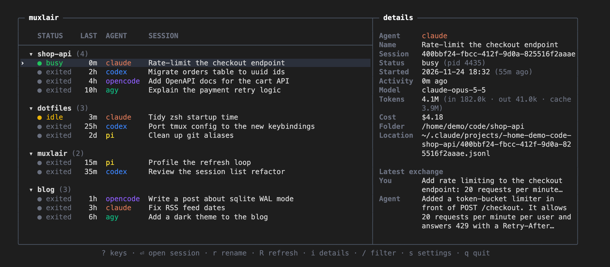

# muxlair

[](https://github.com/phr0nak/muxlair/actions/workflows/ci.yml)
[](LICENSE)
[](go.mod)
[](https://github.com/phr0nak/muxlair/tags)



A terminal dashboard for your local AI coding-agent sessions. `muxlair` lists your Claude Code, Codex, OpenCode and pi sessions grouped by the folder they ran in. From there you can jump to a running session, reopen an old one or rename it, using the keyboard or the mouse, inside [tmux](https://github.com/tmux/tmux) or [cmux](https://cmux.com). It works in Rex too.

### Why "muxlair"?

The name joins two words:

- **mux**, from *multiplexer*, as in `tmux`: many terminal sessions managed through one interface.
- **lair**, a hidden base or den: a dedicated place where your AI agents live and work.

Together, a home base for all your AI coding-agent sessions.

## Quick start

1. [Install](#install) `muxlair`.
2. Start a `tmux` session or open a `cmux` or Rex terminal, then run `muxlair` in it. `muxlair` needs one of them to open sessions.
3. Move to a session with the arrow keys and press `Enter`: `muxlair` jumps to it if it's open, or reopens it if it's closed.
4. Press `?` to see every key, and `s` for settings.

## Supported agents

| Agent | Status |
|---|---|
| [Claude Code](https://docs.anthropic.com/en/docs/claude-code) | Supported |
| [Codex CLI](https://github.com/openai/codex) | Supported |
| [OpenCode](https://opencode.ai) v2 | Supported (list, reopen, rename, details, peek; jump only to a session opened with `opencode -s <id>`) |
| [pi](https://github.com/earendil-works/pi) | Supported (list, reopen, rename while closed, details, peek; a running pi marks its folder's sessions `in use?`) |

## Features

- **All your sessions in one list**, grouped by folder, newest first. Each row shows the session's status, time since its last activity, agent and name, and each agent has its own color.
- **Live status** for every session:

  | Status | Meaning |
  |---|---|
  | `busy` | The agent is working right now. |
  | `idle` | Open and waiting for you. |
  | `exited` | Closed. It can be reopened. |
  | `dead` | The agent can no longer reopen it (its session file is gone). Codex only. |
  | `in use?` | An agent process `muxlair` can't identify may be using it, so `muxlair` won't open or rename it. Codex and pi. |

- **Jump or reopen.** 
  - `Enter` on an open session takes you to its `tmux` window, `cmux` pane or Rex tab. In Rex, showing the tab, and the new tab after reopening, needs Remote Control turned on in the Rex app's Settings, under Rex Server; without it, the tab is selected but the app keeps showing `muxlair`.
  - `Enter` on a closed one reopens it where `muxlair` runs: a new `tmux` window, a new `cmux` workspace, or a new Rex tab.
- **Rename** with `r`. The new name is applied in the agent too. Renaming inside the agent, with `/rename`, updates `muxlair` right away, along with the title of its `tmux` window, `cmux` tab or Rex tab, and its `cmux` workspace when the session is the only terminal in it.
- **Details pane** with the session's ID, folder, file location, start time, last activity, model, token usage and cost, when the agent records them.
- **Conversation peek.** The details pane also shows the latest exchange of the conversation (your last prompt and the agent's answer), and `p` opens it in full. It is read from the session's own file, never summarized, and tool calls and reasoning are left out. See [Conversation peek](#conversation-peek).
- **Mouse support.** Scroll, click, double-click to open, drag the divider to resize the details pane, and drag across text in the details pane to copy it, for example a session ID or a path.
- **Settings** in the app (`s`) or in a config file at `~/.muxlair/config.json`, applied immediately.

## Requirements

- [Go](https://go.dev/dl/) 1.27.1 or newer, to build `muxlair`.
- `tmux`, `cmux` or Rex. `muxlair` runs inside one of them and opens sessions there.
- For copying details text: a clipboard command (`pbcopy`, `wl-copy`, `xclip` or `xsel`), or a terminal that supports clipboard access (OSC 52). Inside `tmux`, the latter needs `set -g set-clipboard on`.
- The agents you use, installed and on your `PATH` (`claude`, `codex`, `opencode`, `pi`). Sessions of every supported agent can be reopened and renamed.

## Install

With Go, in one line (the binary lands in `$(go env GOPATH)/bin`, usually `~/go/bin`, which must be on your `PATH`):

```sh
go install github.com/phr0nak/muxlair/cmd/muxlair@latest
```

Or build from source:

```sh
git clone https://github.com/phr0nak/muxlair
cd muxlair
go build -o muxlair ./cmd/muxlair
mkdir -p ~/.local/bin
cp muxlair ~/.local/bin/
```

`~/.local/bin` must be on your `PATH`. If `muxlair` isn't found afterwards, add this line to your shell's startup file (such as `~/.bashrc` or `~/.zshrc`) and open a new terminal:

```sh
export PATH="$HOME/.local/bin:$PATH"
```

Then start `muxlair` from a `tmux` or `cmux` terminal.

## Keys

Press `?` in `muxlair` to see these at any time.

| Key | Action |
|---|---|
| `↑` `↓` or `j` `k` | Move |
| `Enter` or double-click | Jump to the session, or reopen it |
| `←` `→` or `h` `l` | Collapse / expand a folder |
| `Space` or `Tab` | Toggle a folder |
| `r` | Rename |
| `/` | Filter: type to narrow the list, `Enter` keeps the filter, `Esc` clears it. To clear a kept filter later, press `/` then `Esc`. |
| `i` | Show / hide the details pane |
| `<` `>` | Resize the details pane (dragging the divider works too) |
| Mouse drag in the details pane | Select text; it's copied to the clipboard when you release the button |
| `R` | Refresh |
| `p` | Peek at the latest exchange of the selected session's conversation (`↑` `↓` or the wheel scroll, drag across text to copy it, `Esc` closes) |
| `s` | Settings |
| `?` | Show all keys |
| `q` or `Ctrl+C` | Quit |

## Command line

| Command | What it does |
|---|---|
| `muxlair` | Starts the dashboard. Run it inside `tmux`, `cmux` or Rex. |
| `muxlair --help` (`-h`) | Shows the usage and exits. |
| `muxlair --version` (`-v`) | Prints the version and exits. A release prints its tag, such as `v0.1.0`; a build from source prints `dev` or a commit-based version. |
| `muxlair list` (`--list`) | Prints every session as an aligned table and exits, without starting the dashboard. Useful for debugging or scripting. |

Any other argument prints the usage and exits with status 2.

`muxlair list` prints a header row, then one line per session, newest first. The columns are:

| Column | Meaning |
|---|---|
| `STATUS` | `busy`, `idle` or `exited` |
| `ID` | The agent's session ID |
| `UPDATED` | Last activity, `YYYY-MM-DD HH:MM` |
| `AGENT` | `claude` or `codex` |
| `TTY` | The terminal the session runs in, empty when it isn't running |
| `MAYBELIVE` | `true` when an unidentified agent process may be using it (`in use?` in the dashboard) |
| `CWD` | The folder the session ran in |
| `NAME` | The session name. A Claude session with no title and no prompt yet shows `(unnamed)`; the name Claude makes up from the folder (like `stuff-50`) is not shown |

`muxlair trash`, `muxlair restore` and `muxlair export` were removed in v0.5.0, along with delete (`d`), the Trash popup (`t`) and automatic cleanup. `muxlair` leaves an existing `~/.muxlair/trash` as it is. To restore something from it, install v0.4.1 (`go install github.com/phr0nak/muxlair/cmd/muxlair@v0.4.1`) and use its `muxlair restore`.

## Configuration

There are two ways to configure `muxlair`. Both use the same file, `~/.muxlair/config.json`, and changes apply immediately, without a restart.

### Option 1: the Settings window

Press `s`. Move with `↑` `↓`, change a value with `Space` or `←` `→`, then choose **Save** (or press `Ctrl+S`). `Esc` closes without saving.

### Option 2: edit `~/.muxlair/config.json`

Create `~/.muxlair/config.json` with the content below, then change what you need:

```sh
mkdir -p ~/.muxlair
cat > ~/.muxlair/config.json <<'EOF'
{
  "mouse": true,
  "color_tabs": true,
  "details": true,
  "conversation_peek": true
}
EOF
```

`muxlair` notices when you save the file and applies it. If the file has a mistake, `muxlair` keeps its current settings and shows the problem at the bottom of the screen; if the mistake is already there when `muxlair` starts, it starts with the defaults. Any setting you leave out keeps its default.

### Settings

| Setting | Default | What it does |
|---|---|---|
| `mouse` | `true` | Mouse support. While it's on, text in the details pane is selected and copied by dragging; to select anything else on screen, most terminals need `Shift` held. |
| `color_tabs` | `true` | Colors the `tmux` window tab or `cmux` workspace that `muxlair` opens with the agent's color. |
| `details` | `true` | Shows the details pane at startup. The pane needs a window at least 90 columns wide. `i` still toggles it at any time. |
| `conversation_peek` | `true` | Reads and shows the latest exchange of the conversation in the details pane and with `p`. When it is `false`, `muxlair` does not read any conversation text. See [Conversation peek](#conversation-peek). |

## Conversation peek

With the details pane open, the selected session shows a **Latest exchange** block under its fields: your last prompt and the agent's answer to it, cut to fit. Press `p` to read both in full (`↑` `↓` or the mouse wheel scroll, `Esc` closes); a very long text is cut at 20,000 characters. Drag across the text to select it; when you release the button it is copied to the clipboard, with wrapped lines joined back into the paragraph they came from. Dragging past the top or bottom edge scrolls. It is the real text from the session's file, not a summary, and tool calls, tool output and reasoning are never shown. Control characters in the text are removed before it is drawn.

- **Claude:** the last prompt you typed and the last text the agent wrote after it. A reply that was interrupted, or that stopped at a tool call, is marked "the reply stopped early"; a session that is still busy shows "working…". Subagent conversations, slash commands and Claude's own context messages are skipped.
- **Codex:** the same, from the session file (the final answer; its progress notes only until the final answer arrives). Codex 0.166 is the version checked. A session whose file is gone (`dead`) shows nothing.
- **OpenCode:** the last prompt and the last text the agent wrote after it, from OpenCode's database; reasoning and tool output are left out. OpenCode 2.3 is the version checked.
- **pi:** the last prompt and the last text the agent wrote after it, from the session file; thinking and tool calls are left out. pi 1.6 is the version checked.
- **Not shown** when there is no room in the pane, or when the session has no prompt yet.
- **Privacy.** The text appears on your screen, so anyone who can see it can read your conversation. Set `conversation_peek` to `false` (or turn it off in Settings, `s`) and `muxlair` reads no conversation text at all.

## What `muxlair` reads and changes

`muxlair` makes no network connections of its own. It reads local files and runs local commands: `tmux`, `cmux`, `rex`, `lsof`, `ps`, `codex` to rename Codex sessions, `opencode api` to rename OpenCode sessions, and `pi --mode rpc` to rename pi sessions. Reopening a session starts the agent itself (`claude`, `codex`, `opencode` or `pi`) in a new terminal; the agents are separate programs and do whatever they normally do.

`muxlair` reads each agent's own session files: `~/.claude` for Claude Code, `~/.codex` (or `$CODEX_HOME`) for Codex, and OpenCode's database, `~/.local/share/opencode/opencode.db` (or under `$XDG_DATA_HOME`), opened read-only, and `~/.pi/agent/sessions` (or `$PI_CODING_AGENT_DIR`, `$PI_CODING_AGENT_SESSION_DIR`) for pi. It changes them in only one case:

- **Rename:**
  - **A closed session:** a Claude session gets the same rename record `/rename` would write. A Codex session is renamed through Codex's own app server. An OpenCode session, closed or running, is renamed through OpenCode's own server (`opencode api session.update`), so nothing is typed into its terminal. A closed pi session is renamed by pi itself (`pi --mode rpc --offline` with `set_session_name`, which appends the record `/name` writes; no model is called).
  - **A running session:** `muxlair` types `/rename <name>` into its terminal (a `tmux` pane, a `cmux` tab or workspace, or a Rex tab). It does this only when the session is idle and its input box is empty, so nothing you're typing gets sent. In `tmux` and Rex, and for Codex in `cmux`, `muxlair` reads the screen to check; for Claude in `cmux`, `cmux` itself guards the input box.
  - **If it can't type:** the terminal isn't a `tmux` pane, `cmux` tab or workspace, or Rex tab it can reach, the session is busy, or you have a draft in the input box.
    - A Codex session is still renamed through the app server. `muxlair` tells you the open session keeps its old name until you run `/rename` there or reopen it.
    - A Claude session is not renamed. Run `/rename` there yourself.
  - **A new Claude session:** its empty input box shows a dimmed example prompt. `muxlair` treats a prompt that is entirely dimmed text as empty, so a new session can be renamed before its first message. Until it has a title or a prompt, it shows as `(unnamed)` in the list, not the name Claude makes up from the folder. A new Codex session only appears in the list after its first message, because Codex creates it then. Anything typed there is normal text, so a draft still blocks the rename.

`muxlair`'s own file is `~/.muxlair/config.json`. Versions before v0.5.0 also kept a `trash` folder and `interactive.json` (with `interactive.lock`) there; v0.5.0 no longer uses them and leaves them alone.

## Troubleshooting

- **A session in `cmux` can't be reached from `muxlair` running in another terminal.** By default, `cmux` only accepts commands from programs started inside `cmux`. Run `muxlair` inside `cmux`, or change `cmux`'s socket control setting so other programs may connect.
- **A session shows `in use?`.** An agent process `muxlair` can't match to a session is running in that folder, for example one sitting in its session picker. Close it, or wait for it to finish.
- **A Codex session shows `dead`.** Its conversation file is gone, so Codex can't reopen it. `codex delete <id>` removes it from Codex.
- **Every Codex session shows `in use?`.** `muxlair` uses `lsof` to tell which session a running `codex` process belongs to. If `lsof` isn't installed (some minimal Linux systems), it can't tell, so it blocks opening Codex sessions. Install `lsof`.

## Known limitations

- **Agent file formats can change.** `muxlair` reads Claude Code's, Codex's and OpenCode's own files (transcripts, session records, their databases). These are not stable, documented interfaces, so an agent update can break session discovery, names or the details pane until `muxlair` catches up.
- **Platforms.** `muxlair` is developed and tested on macOS only. It has not been tested on Linux, and may not work there yet. Known issue: if Codex runs with its shared app-server daemon, a running Codex session can't be matched to its terminal, so jump and rename-in-place don't work for it. Windows is not supported.
- **OpenCode: jump only with `-s`.** `muxlair` knows which session an OpenCode terminal shows only when it was started as `opencode -s <id>`, as `muxlair` itself does. One started as plain `opencode` isn't matched, so `Enter` opens another view of the session instead of jumping; OpenCode's server keeps both in sync.
- **pi: no jump, and a running pi blocks its folder.** pi replaces its process arguments with `pi` and keeps no lock file, so `muxlair` can't tell which session a running pi has open. Every pi session in that folder shows `in use?` and can't be opened or renamed from `muxlair` until that pi exits; rename it there with `/name`.
- **Only Claude Code, Codex, OpenCode and pi.** Other agents are not supported yet.
- **Rex tabs get no agent color.** Rex has no tab colors to set, so `color_tabs` only applies in `tmux` and `cmux`.

## License

`muxlair` is released under the [MIT License](LICENSE).

`muxlair` is an independent project. It is not affiliated with, endorsed by or sponsored by Anthropic or OpenAI. Claude, Claude Code, Codex and the other product names are trademarks of their respective owners.
